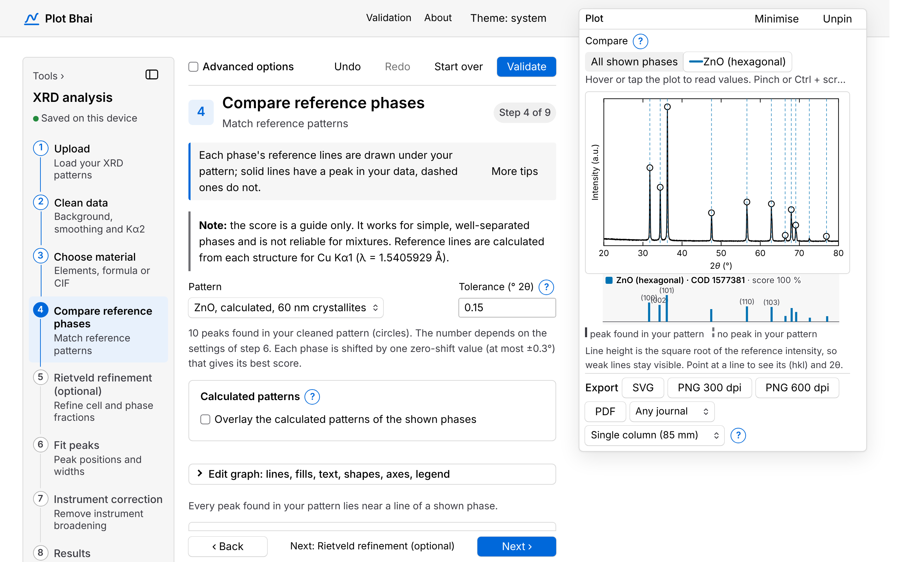
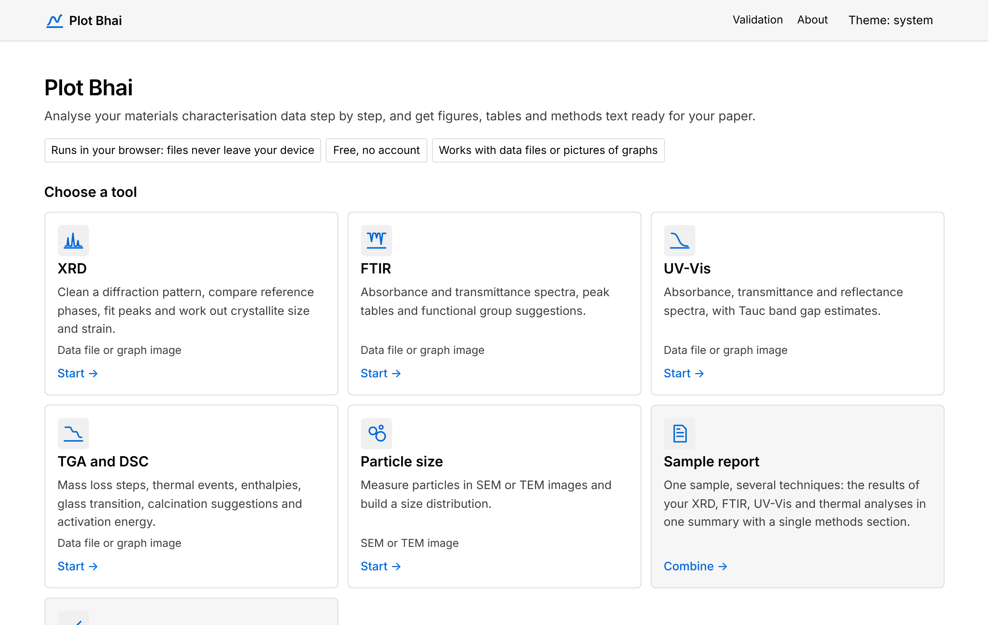
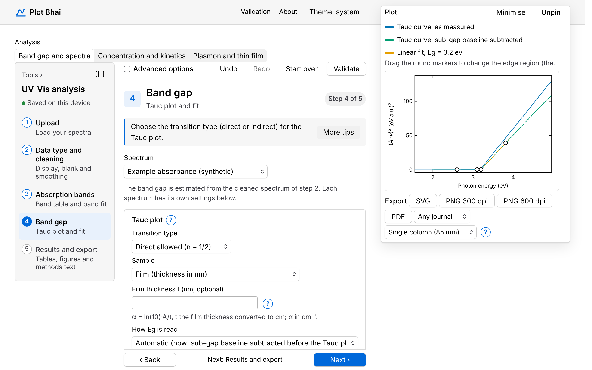
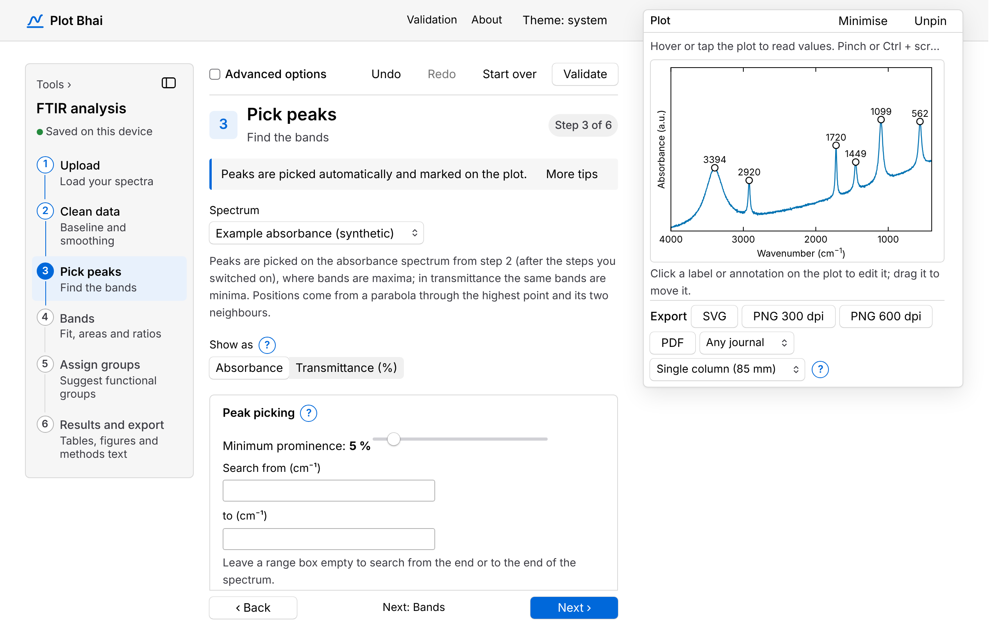
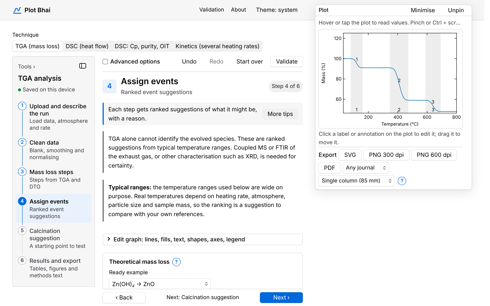
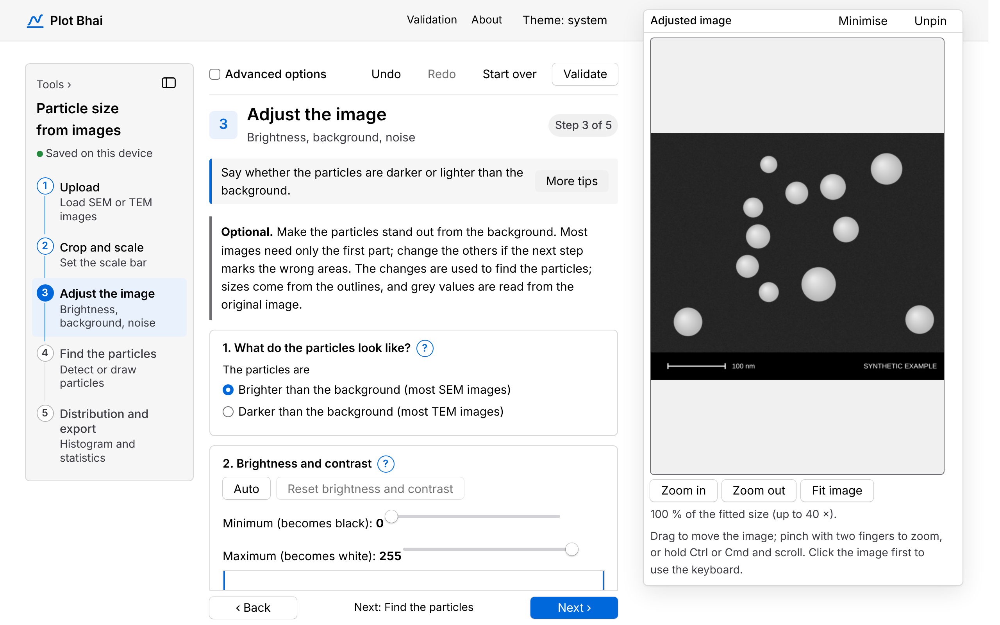
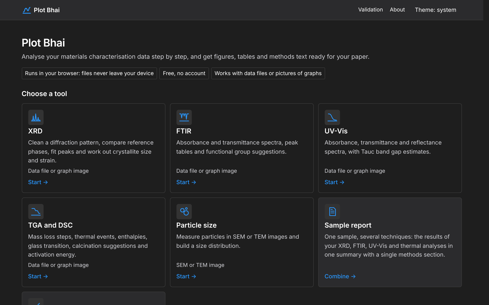

<div align="center">


# Plot Bhai

**Analyse materials characterisation data step by step, and get figures, tables and methods text
ready for your paper.**

XRD · Rietveld · UV-Vis · FTIR · TGA / DSC · Particle size from SEM / TEM

[](https://plot-bhai.web.app)

[](https://doi.org/10.5281/zenodo.24222105)
[](CHANGELOG.md)
[](https://github.com/shumsularefin/Plot-bhai/actions/workflows/ci.yml)
[](https://plot-bhai.web.app/#/validation)
[](LICENSE)


<br />

<picture>
  <source media="(prefers-color-scheme: dark)" srcset=".github/assets/xrd-dark.png" />
  
</picture>

</div>

---

## Why Plot Bhai?

- 🧭 **A wizard, not a manual.** Every tool is a short sequence of steps with one main action each,
  clear Back and Next, and a "What is this?" note on every technical term.
- 🔒 **Your data stays on your device.** All processing runs in your browser. No accounts, no
  file uploads, no tracking cookies, and no third-party scripts or fonts (only an anonymous
  first-party visit and completion counter; details in [DATA-SOURCES.md](DATA-SOURCES.md)).
- 📄 **Publication ready.** SVG, PNG at 300 / 600 dpi and PDF figures at journal column widths,
  CSV for every table, and a "Methods text" paragraph written from the settings you actually used.
- ✅ **Validated three ways.** Every numerical method is checked against synthetic data with a known
  answer, against independent programs (GSAS-II, pymatgen, SciPy, lmfit, ImageJ and others) and with
  round-trip checks. The full record is public on the [validation page](https://plot-bhai.web.app/#/validation).
- ⚠️ **Honest about limits.** Estimates are labelled as estimates, and warnings appear in plain
  language where the problem happens.
- 💾 **Never lose your work.** Sessions are saved in the browser, every step has undo and reset,
  and a session file can be exported and reopened later. Tools work offline once opened.

## Tools

| Tool                    | What it does                                                                                                                                                                                                                                                                              |
| ----------------------- | ----------------------------------------------------------------------------------------------------------------------------------------------------------------------------------------------------------------------------------------------------------------------------------------- |
| **XRD**                 | Import common instrument formats, clean the pattern, match reference phases from the open Crystallography Open Database, view the crystal structure in 3D, index an unknown pattern, fit peaks, correct for the instrument, and work out crystallite size, strain and lattice parameters. |
| **Rietveld refinement** | Optional, inside the XRD tool: cell, phase fractions, profile, size and microstrain, preferred orientation, Le Bail mode and, under Advanced, atom positions, occupancies and displacement parameters. Exports a GSAS-II starting set to check or continue the refinement.                |
| **UV-Vis**              | Absorbance, transmittance and reflectance spectra, Tauc band gap, concentration and kinetics, plasmon bands and thin films.                                                                                                                                                               |
| **FTIR**                | Baseline and smoothing, peak picking, band fitting, peak tables and ranked functional group suggestions.                                                                                                                                                                                  |
| **TGA and DSC**         | Mass loss steps with DTG, onset / peak / endset temperatures, T5, T10 and T50, enthalpy, glass transition, ranked event suggestions, a calcination starting point and multi-rate activation energy.                                                                                       |
| **Particle size**       | Set the scale bar on an SEM or TEM image, detect or draw particles, and build a size distribution with statistics.                                                                                                                                                                        |
| **Sample report**       | Combine the XRD, FTIR, UV-Vis, thermal (TGA/DSC) and particle size results for one sample into a single summary with one methods section.                                                                                                                                                 |

Size and strain methods: Scherrer, Monshi–Scherrer, Williamson–Hall (UDM, USDM, UDEDM), size–strain
plot and Halder–Wagner, plus dislocation density, texture coefficient and crystallinity index.

## Screenshots

<table>
  <tr>
    <td width="50%"><br /><sub><b>Home:</b> choose a tool, or try it with example data.</sub></td>
    <td width="50%"><br /><sub><b>UV-Vis:</b> Tauc plot with an adjustable edge region.</sub></td>
  </tr>
  <tr>
    <td><br /><sub><b>FTIR:</b> automatic peak picking on the spectrum.</sub></td>
    <td><br /><sub><b>TGA:</b> mass loss steps and ranked event suggestions.</sub></td>
  </tr>
  <tr>
    <td><br /><sub><b>Particle size:</b> detect or draw particles on an SEM or TEM image.</sub></td>
    <td><br /><sub><b>Dark theme</b>, colour-blind safe plots, and a layout that works from phones to wide screens.</sub></td>
  </tr>
</table>

<sub>The screenshots use the built-in example data, which is synthetic, not real measurements.</sub>

## Quick start

1. Open **[plot-bhai.web.app](https://plot-bhai.web.app)**. Nothing to install.
2. Pick a tool and press **Try with example data** to see every step, or drop in your own file.
3. Follow the steps, then export your figures, tables and methods text.

Supported XRD files include .xy, .xye, .dat, .txt, .csv, PANalytical .xrdml, Rigaku .ras and .rasx,
Bruker .brml and .raw, and pictures of graphs (digitised in the browser).

## Run it locally

Requires Node.js 22 or newer.

```sh
git clone https://github.com/shumsularefin/Plot-bhai.git
cd Plot-bhai
npm install
npm run dev        # local dev server at http://localhost:5173
```

| Command             | What it does                                                                 |
| ------------------- | ---------------------------------------------------------------------------- |
| `npm run lint`      | ESLint and Prettier check (`npm run format` fixes formatting)                |
| `npm run typecheck` | TypeScript, strict mode                                                      |
| `npm test`          | Vitest unit tests                                                            |
| `npm run build`     | Type check and production build into `dist/`                                 |
| `npm run size`      | After a build: fails if the initial JavaScript is over 150 KB gzipped        |
| `npm run e2e`       | End-to-end run of the tools in a headless browser                            |
| `npm run audit`     | Checks every tool at 360, 768, 1280 and 1920 px for layout and accessibility |
| `npm run preview`   | Serve the production build locally                                           |

Built with [Vite](https://vite.dev), TypeScript, [Preact](https://preactjs.com) and a few
[D3](https://d3js.org) modules. Charts are SVG, so the same markup exports to SVG, PNG and PDF.
Hosting setup is in [docs/deploying.md](docs/deploying.md).

<details>
<summary><b>Project structure</b></summary>

```
src/core/          pure TypeScript science code, no UI imports, fully unit tested
src/modules/       one lazy-loaded folder per tool (xrd, uvvis, ftir, particles, thermal)
src/ui/            app shell, wizard, plots, design tokens and themes
src/workers/       web workers for heavy computation
data/              reference patterns (from COD), FTIR, thermal and crystallographic tables
scripts/           build-time scripts and the independent validation scripts
tests/             unit tests, synthetic fixtures and real instrument files
worker/            read-only COD lookup (Cloudflare Worker)
worker-feedback/   anonymous feedback counter (Cloudflare Worker)
docs/              validation record, method notes and deployment
```

</details>

## Privacy

Uploaded files never leave your browser. The only network requests are the optional COD lookup
(element symbols, formulas or COD numbers) and the optional feedback counter (a random browser ID,
the section name, a verdict and an optional comment). The site works fully without both. Details
are in [DATA-SOURCES.md](DATA-SOURCES.md).

## Citing Plot Bhai

If you use Plot Bhai in published work, please cite it (see [CITATION.cff](CITATION.cff)):

> Arefin, S. (2026). Plot Bhai: a client-side wizard for XRD, UV-Vis, FTIR, particle size and
> thermal analysis (Version 1.1.0) [Computer software]. Zenodo.
> https://doi.org/10.5281/zenodo.24222105

The concept DOI always points to the latest version. Please also cite the original paper or COD
entry of every reference pattern you used.

## Contributing

Bug reports and suggestions are welcome as [issues](https://github.com/shumsularefin/Plot-bhai/issues).
For a scientific error, please include the input file, the settings, the value you expected and its
source. See [CONTRIBUTING.md](CONTRIBUTING.md) and, for security reports, [SECURITY.md](SECURITY.md).

## Credits and licence

Designed and developed by [Shumsul Arefin](https://shumsul-arefin.web.app), supervised by
Dr. MD Kamruzzaman and S. M. Fazle Rabbi, Department of Applied Chemistry and Chemical Engineering,
Gopalganj Science and Technology University.

Code: [MIT licence](LICENSE). Data files keep their own terms ([DATA-SOURCES.md](DATA-SOURCES.md));
bundled libraries are listed in [THIRD-PARTY-NOTICES.md](THIRD-PARTY-NOTICES.md). Reference
patterns come from the open [Crystallography Open Database](https://www.crystallography.net/); no
JCPDS/ICDD data are bundled.
